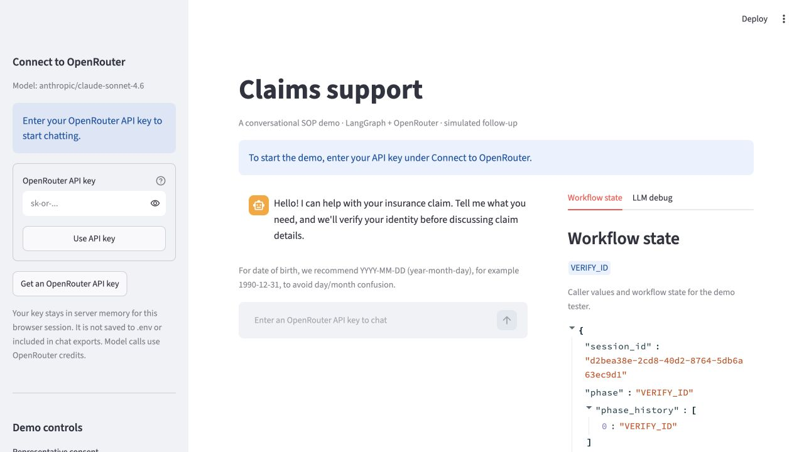

# Delivery guide

Use this guide to demonstrate the four-phase insurance workflow and review the delivery against the
[original assignment](../assignment/original.txt). Start the app using the
[README](../../README.md#run-locally) or its [Docker instructions](../../README.md#run-with-docker).

## What the delivery contains

| Item | Location |
| --- | --- |
| Chat, workflow inspector, and model diagnostics | `app.py`, `apps/insurance_claims/ui/app.py` |
| API key entry and session isolation | `apps/insurance_claims/ui/connection.py` |
| Container build and secret exclusions | `Dockerfile`, `.dockerignore` |
| Deterministic SOP and model contracts | [Workflow design](workflow.md) |
| Synthetic customers, claims, and guidance | `apps/insurance_claims/data/fixtures/` |
| Offline tests and live scenario runner | `tests/`, `evals/__main__.py` |
| Response-quality criteria | [Conversation rubric](../../evals/rubric.md) |

## Connect to OpenRouter



1. In **Connect to OpenRouter**, click **Get an OpenRouter API key** if you need a key.
2. Enter the key in **OpenRouter API key**, then click **Use API key**.
   The field masks your input. A configured key enables chat and the demo clock controls.
3. Send a message to check the connection. Configuration alone does not validate the key, account
   credits, or model access.

To replace a key, enter another key and click **Use API key**. The next turn uses the new key
without
resetting the conversation. To remove the override, click **Clear session key**. The app then uses a
server key if configured; otherwise, chat and **Advance time** are disabled.

The app holds a UI key in server memory for one browser session. It does not write the key to
`.env`,
change process environment variables, or include the key in model prompts, diagnostic traces, or
downloaded outcomes. **New conversation** retains the connection. Reloading or restarting can end
the session and require you to enter the key again.

## Walk through the four phases

This sequence separates verification from case processing so you can inspect the privacy boundary.
Exact reply wording can vary. Use the expected behavior to assess each turn.

1. Click **New conversation**. Keep **New conversation date** at March 10, 2026.
2. In the chat, send:

   ```text
   I'm the policyholder Margaret Chen, policy POL-9921. I need help with my denied healthcare
   claim from January.
   ```

   In **Workflow state**, the phase should remain `VERIFY_ID`. The name supplies one PII field;
   the policy number does not count. The agent should retain the January claim hint and ask for
   additional identity details without disclosing protected claim records.

3. Send:

   ```text
   My DOB is 1985-03-15, and my SSN last four is 4472.
   ```

   Three matching fields authorize access. The harness passes through `RESOLVE_INTENT` and selects
   `CL-2048` using the remembered hint. In `PROCESS_CASE`, the reply should explain that the review
   file lacked the pathology report and treating provider office note. It should not restart intake.
   The phase history records intermediate phases even when one turn crosses several of them.

4. Ask `Can I send a scan?`.
   The answer should use the authorized document guidance and retain any original-document
   qualification. A scan question should not become an unsupported promise of acceptance.
5. Send `That answers my question. That's all I need.`.
   In `POST_PROCESS`, the agent should offer the optional summary and wait for a choice.
6. Send `Yes, send the summary email.` or `No thanks, skip the email.`.
   Either explicit choice completes the conversation. Send prepares an email draft, including the
   discussed outcome and major next steps, and records `simulated_only` delivery. Skip records the
   decision without delivery. Inspect **Support outcome**, then click **Download outcome**.

To run the single-message example exactly as provided in the assignment, use the
[README example](../../README.md#try-the-assignment-example).

## Try recovery and scope limits

Start a new conversation for each scenario.

| Scenario | Action | Expected behavior |
| --- | --- | --- |
| Frustration | Demand details before verification. | Empathy, privacy explanation, ID options. |
| Alternate ID | Supply name, DOB, and email. | Three matching fields can verify identity. |
| Unrelated requests | Ask unrelated questions three times. | Refusals, then a human-support offer. |
| Identity correction | Correct identity after verification. | Access is revoked and rechecked. |
| Human request | Ask for a representative. | A handoff request; no actual transfer. |
| Expired appeal | Start after March 18, 2026; ask about `CL-2048`. | Reflect the expired deadline. |

The demo offers human support after three distinct failed verification submissions or two refusal
turns without identity progress. Clarifications and emotion alone do not count as failed attempts.
Those thresholds are demo policies. The assignment requires recovery and escalation but does not
prescribe these numbers.

Use `YYYY-MM-DD` for birth dates to avoid day/month ambiguity. Unambiguous alternatives are
accepted;
ambiguous dates require clarification. The scenario collection also covers national IDs, multiple
claims, unavailable answers, early email choices, and follow-up questions at closing. See the
[coverage catalog](../../evals/README.md#coverage).

## Demonstrate conversation timeout

1. Start a new conversation, or leave an active claim conversation waiting for the caller.
2. Under **Advance by**, select **180 seconds**, then click **Advance time**.
3. Confirm that the conversation is `timed_out`, email is skipped, and chat is disabled.
4. Click **New conversation** to start again with a fresh three-minute wait.

The rule applies in every phase. Caller messages reset the wait; clock steps and UI reruns do not.
If an email or representative-consent deadline occurs earlier, that timeout takes precedence.
The notice above chat and the sidebar explain the rule. Real elapsed time does not count.

## Demonstrate email-choice timeout

1. Reach the email-summary offer and leave the send/skip choice unanswered.
2. Under **Advance by**, select **120 seconds**, then click **Advance time**.
3. Confirm that the conversation completes with email choice `skip`, offer status `timed_out`,
   and delivery `not_requested`. The support summary remains available. No email is sent.

The sidebar shows the remaining demo seconds. Reminders do not extend the wait. A new claim
question is answered before a fresh waiting period starts. A remembered send preference does not
override timeout. Time moves only through **Advance time**, not by waiting two real minutes.

## Demonstrate representative consent

1. In **Demo controls**, select `default` for **Representative consent**, then click
   **New conversation**.
2. Send:

   ```text
   I'm David Chen, Margaret Chen's son, calling for her about her denied January healthcare
   claim. Her DOB is 1985-03-15 and her SSN last four is 4472.
   ```

   Consent starts as pending. No claim details should be disclosed.

3. Set **Advance by** to `10 seconds`, then click **Advance time**.
   The default fixture approves consent, permitting claim access.

To demonstrate expiry, select `timeout`, start a new conversation, repeat the caller details, and
advance by `120 seconds`. Consent expires and the harness requests human support. No consent
request or transfer is actually sent.

The clock starts at March 10, 2026, 10:00 UTC and moves only when you click **Advance time**.
Consent checks are eligible every 10 seconds, with one check per event. Expiry is checked before
polling, so jumping directly to 120 seconds cannot grant late approval.

## Configure server settings

UI setup needs no `.env` file. For live command-line evaluations or monitoring, copy `.env.example`
to `.env` on a fresh checkout and edit the values. Preserve an existing `.env` file.

| Setting | Purpose | Default |
| --- | --- | --- |
| `OPENROUTER_API_KEY` | Server key; required for live CLI evaluations. | Empty |
| `OPENROUTER_MODEL` | Model with structured output support. | `anthropic/claude-sonnet-4.6` |
| `LANGFUSE_PUBLIC_KEY` | Optional tracing project public key. | Empty |
| `LANGFUSE_SECRET_KEY` | Optional tracing project secret key. | Empty |
| `LANGFUSE_BASE_URL` | Langfuse endpoint; required with tracing keys. | See `.env.example` |
| `LANGFUSE_TRACING_ENVIRONMENT` | Trace environment label. | `development` |
| `LANGFUSE_TRACING_ENABLED` | Set to `false` to disable export. | `true` in `.env.example` |

A UI key overrides the server key for that browser session. Environment variables override `.env`
values. Empty credentials in the environment disable file-based credentials. An unset or blank model
uses the default. Restart the app after changing server settings.

To provide server configuration to Docker at runtime, use:

```shell
docker run --rm --name insurance-sop -p 127.0.0.1:8501:8501 --env-file .env insurance-sop
```

The image never copies `.env`. A server key is shared by sessions that do not supply their own key.
For a public deployment, provide an access policy and HTTPS before collecting credentials.

### Inspect model calls

Open **LLM debug** to inspect extraction and response calls, prompts, schemas, raw and parsed
output,
latency, and provider token counts. The UI streams unvalidated JSON into a tester panel; it displays
the customer reply only after validation. Failed-call diagnostics survive a failed turn.
Missing token metadata is shown as unavailable. **New conversation** clears local traces.

Set all three Langfuse connection values to enable optional export. Missing, partial, or blank
connection settings leave export off and do not block chat. Each conversation is a Langfuse session
when export is enabled. Each `support-turn`
trace contains `extract-facts` and `compose-reply` generations plus an `apply-sop` decision span.
Fixed replies skip response generation. Live reports include trace links when tracing is enabled.

Export masking pseudonymizes known fixture identity values and common email/phone forms. Local
model inputs and inspector values remain unchanged. Arbitrary identity details in free text may
survive masking. Use the synthetic fixtures. Langfuse cost totals depend on its model-pricing match.

## Review assignment coverage

| Assignment requirement | Implementation and review evidence |
| --- | --- |
| Runnable delivery | Local setup, Dockerfile, and UI key entry in the README. |
| Natural-language test UI | Streamlit chat, outcome download, and workflow/debug tabs. |
| Fixed four-phase SOP | Code owns transitions and allowed actions; models cannot set the phase. |
| At least three PII fields | Distinct matches on one customer; policy number excluded. |
| No early disclosure | Guarded claim reads; extractor has no claim records. Review replies too. |
| Early memory | Caller facts and case hints persist across verification and consent. |
| Grounded processing | Responses receive authorized evidence; references are validated. |
| Optional follow-up | Explicit send/skip, or automatic skip on timeout; draft and delivery state are separate. |
| Scope limits | Model classifies scope; code refuses and counts unrelated retries. |
| Bonus empathy and recovery | Prompts guide empathy; code controls refusal and handoff. |

Identity corrections revoke access and discard the former customer's outcomes. Claim switches keep
separate outcomes for the same customer so a closing summary can cover all discussed claims.
The harness preserves full dialogue within the current identity boundary. It has no turn cap or
automatic summarization; very long conversations can exceed the model context limit.

Code validates structured outputs and evidence references. It cannot prove that every generated
sentence is grounded, empathetic, or complete. Offline tests exercise business contracts with
scripted models. Live scenarios need separate semantic review using the
[SOP review skill](../../.agents/skills/sop-eval-review/SKILL.md) and
[rubric](../../evals/rubric.md).

## Delivery verification

See the [October 9 submission review](submission-review.md) for the newer Docker, hosted UI,
default-model evaluations, local corrections, and GitHub ZIP readiness findings.

The October 8, 2026 delivery was checked in the current working tree:

- `uv sync --locked`: passed.
- `uv run pytest -q`: 93 tests passed, including key entry, replacement, clearing, and session
  isolation.
- Ruff lint, formatting, and `git diff --check`: passed.
- Browser check: the first-run prompt appears; entering a key enables chat; clearing it disables
  chat.
- Docker: `insurance-sop:delivery` built and passed its HTTP health check. A container smoke check
  verified the non-root user, fixture loading, credential exclusion, and first-run UI.
  The local Docker credential helper stalled; a temporary anonymous configuration allowed the
  public image downloads. No persistent Docker settings were changed.
- Live scenarios: 13 turns across `upfront`, `recovery`, and `scope_retries` using the local
  configured
  model, `anthropic/claude-sonnet-5.5`; all deterministic checks passed.
- Default-model check: 3 `upfront` turns using `anthropic/claude-sonnet-4.6`; all state checks
  passed.

After the directory reorganization, all 93 offline tests passed again. The evaluation CLI listed
all 31 cases, resource loading passed from another working directory, and the rebuilt Docker image
passed its health and first-run UI checks. All 21 prompt, fixture, and scenario files are unchanged
byte for byte. Code comparison found only import, resource-location, and test-alias changes, plus
package initialization. The live results below are from the earlier delivery runs; they were not
rerun for the directory changes.

The optional-monitoring follow-up passed 97 offline tests. UI regression cases confirm that absent,
partial, and blank Langfuse connection settings allow chat turns to complete while tracing stays
off. These checks use scripted model replies and make no live model calls.

The implementing agent reviewed all 16 replies and closing drafts using the rubric. The three
Sonnet 5.5 cases passed their applicable dimensions. The default-model run has one grounding
concern: its first reply recommends submission "as part of your appeal or resubmission," while that
turn's evidence only establishes obtaining copies and a recorded appeal deadline. The additional
route is not established by the evidence. This concern remains unresolved; a state pass is not an
overall conversational acceptance result.

Local evidence is saved in the ignored `outputs/` directory:

- `delivery-2026-10-08.json`
- `delivery-default-model-2026-10-08.json`
- `delivery-review-2026-10-08.md` (self-review, not independent validation)

These runs cover only the selected scenarios. The full live suite, hosted deployment, real external
services, and remote Langfuse export were not validated in this delivery check.

## Troubleshoot setup

| Symptom | Action |
| --- | --- |
| Chat is disabled | Enter a key and click **Use API key**; start a new conversation if completed. |
| A turn fails | Check the key, account credits, model access, and network; inspect **LLM debug**. |
| Structured output fails | Select a model that supports JSON-schema structured outputs. |
| Langfuse traces are absent | Set all three connection values to enable export; chat works without them. |
| Port 8501 is occupied | Stop the other app, or use local port 8502 and open that port. |
| Docker cannot connect | Start Docker Desktop or your Docker engine, then build again. |
| Consent stays pending | Use **Advance time**; real elapsed time does not move the demo clock. |

For local port 8502, append `--server.port 8502` to the Streamlit command. For Docker, change the
port mapping to `-p 127.0.0.1:8502:8501`.

The guide uses task-oriented steps, sentence-case headings, and explicit outcomes following
[Google's documentation style guidance](https://developers.google.com/style/highlights).
